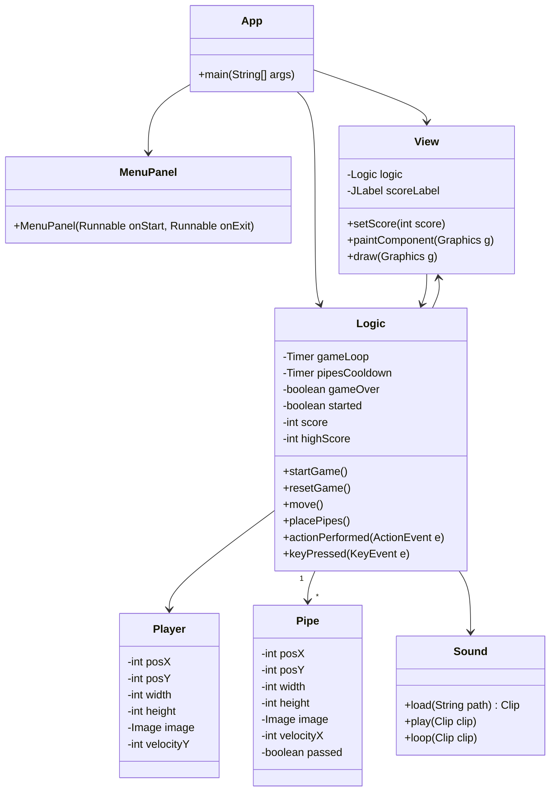
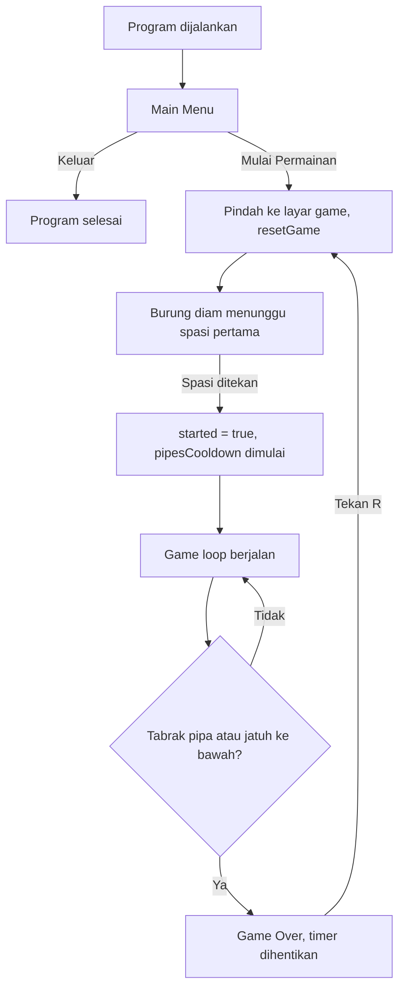

# Flappy Bird - Java Swing GUI

Tugas Praktikum 6 - Desain dan Pemrograman Berbasis Objek (DPBO)

## Janji

Saya Bentar Bintang Umeir dengan nim 2509865 mengerjakan TP6 dalam mata kuliah DPBO untuk keberkahanNya maka saya tidak melakukan kecurangan seperti yang telah dispesifikasikan. Aamiin 

---

## 1. Desain Program

Program ini adalah replika game Flappy Bird yang dibuat dengan Java Swing. Program dibagi menjadi beberapa class dengan tanggung jawab yang terpisah: data objek, tampilan, aturan permainan, dan audio.

### Struktur Folder

```
TP6DPBO2526C2/
├── src/
│   ├── App.java
│   ├── MenuPanel.java
│   ├── View.java
│   ├── Logic.java
│   ├── Player.java
│   ├── Pipe.java
│   ├── Sound.java
│   └── assets/
│       ├── background.png
│       ├── bird.png
│       ├── upperPipe.png
│       ├── lowerPipe.png
│       ├── jump.wav
│       ├── score.wav
│       └── hit.wav
├── Dokumentasi/
└── README.md
```

### Tanggung Jawab Tiap Class

| Class | Peran |
|---|---|
| `App` | Titik masuk program. Membuat `JFrame`, `CardLayout`, dan berpindah antara layar menu dan layar game. |
| `MenuPanel` | Layar Main Menu dengan 2 tombol: **Mulai Permainan** dan **Keluar**. |
| `View` | Kanvas game (`JPanel`). Menggambar background, pipa, burung, layar Game Over, dan menampung `JLabel` skor. |
| `Logic` | Otak permainan. Menyimpan state, menjalankan game loop (`Timer`), gravitasi, pergerakan, deteksi tabrakan, skor, restart, dan input keyboard. |
| `Player` | Data burung: posisi, ukuran, gambar, kecepatan vertikal (`velocityY`). |
| `Pipe` | Data pipa: posisi, ukuran, gambar, kecepatan horizontal, dan status `passed`. |
| `Sound` | Helper untuk memuat dan memutar file audio `.wav`. |

### Diagram Class



`Logic` mengimplementasikan `ActionListener` (untuk game loop dari `Timer`) dan `KeyListener` (untuk input keyboard). `View` dan `Logic` saling mengenal: `View` membaca data dari `Logic` untuk digambar, sedangkan `Logic` memanggil `view.repaint()` dan `view.setScore()` untuk memperbarui tampilan.

### Fitur

**Spesifikasi wajib**

1. Game Over saat burung menabrak pipa atau jatuh ke batas bawah frame.
2. Restart dengan menekan tombol **R** setelah Game Over.
3. Skor ditampilkan menggunakan `JLabel`.
4. Skor bertambah +1 setiap burung melewati sepasang pipa.
5. Main Menu dengan 2 tombol: mulai permainan dan keluar.

**Bonus**

- Audio: BGM, efek lompat, efek skor, dan efek tabrakan (format `.wav`).

**Fitur kreatif tambahan**

- Background bergambar.
- High score selama program berjalan, ditampilkan di layar Game Over.
- Kecepatan pipa meningkat setiap kelipatan 5 skor (maksimal kecepatan -6).
- Burung diam sampai spasi pertama ditekan, sehingga pemain punya waktu bersiap.
- Layar Game Over dengan lapisan gelap transparan.
- Pipa yang sudah keluar layar dihapus dari list agar tidak membebani memori.

---

## 2. Penjelasan Alur

### Alur Umum Program



### Alur Detail

**1. Inisialisasi (`App`)**
`App` membuat `JFrame`, lalu `JPanel` container dengan `CardLayout`. Dua panel dimasukkan ke dalamnya: `MenuPanel` (kartu `"menu"`) dan `View` (kartu `"game"`). Yang tampil pertama adalah menu.

**2. Main Menu (`MenuPanel`)**
Tombol **Mulai Permainan** memindahkan kartu ke `"game"`, memanggil `logika.startGame()`, lalu meminta fokus keyboard untuk `View`. Tombol **Keluar** memanggil `System.exit(0)`.

**3. Game Loop (`Logic`)**
Ada dua `Timer`:

- `gameLoop` berjalan sekitar 60 kali per detik. Setiap tick memanggil `move()` lalu `view.repaint()`.
- `pipesCooldown` berjalan setiap 1,5 detik dan memanggil `placePipes()` untuk memunculkan sepasang pipa baru.

**4. Pergerakan (`move()`)**
- Kecepatan vertikal burung bertambah oleh gravitasi, lalu posisi Y burung diperbarui.
- Setiap pipa digeser ke kiri sebesar `pipeVelocityX`.
- Selama burung belum menekan spasi pertama (`started == false`), `move()` tidak melakukan apa pun.

**5. Pembuatan Pipa (`placePipes()`)**
Posisi Y pipa atas dihitung secara acak, lalu pipa bawah ditempatkan dengan celah tetap sebesar seperempat tinggi frame. Kedua pipa dimasukkan ke `ArrayList<Pipe>`.

**6. Deteksi Tabrakan**
Memakai metode AABB (*axis-aligned bounding box*). Burung dan pipa dianggap bertabrakan jika kotak keduanya tumpang tindih di sumbu X **dan** sumbu Y. Game Over juga terjadi jika bagian bawah burung menyentuh batas bawah frame.

**7. Skor**
Setiap pipa atas yang sudah melewati posisi X burung dan belum bertanda `passed` akan menambah skor satu kali. Hanya pipa atas yang dihitung agar satu pasang pipa tidak dihitung dua kali. Skor ditampilkan di `JLabel`, dan setiap kelipatan 5 skor pipa bergerak lebih cepat.

**8. Game Over (`endGame()`)**
`gameOver` menjadi `true`, kedua timer dihentikan, BGM dihentikan, dan efek tabrakan diputar. `View` kemudian menggambar layar Game Over berisi skor, high score, dan petunjuk menekan R.

**9. Restart (`resetGame()`)**
Dipanggil saat menekan **R** setelah Game Over. Posisi dan kecepatan burung direset, list pipa dikosongkan, skor kembali 0, kecepatan pipa kembali ke awal, dan game kembali menunggu spasi pertama.

**10. Urutan Menggambar (`View.draw()`)**
Urutannya penting karena yang digambar lebih dulu berada di belakang:

1. Background
2. Pipa
3. Burung
4. Lapisan Game Over (jika `gameOver` bernilai true)

### Kontrol

| Tombol | Fungsi |
|---|---|
| `Spasi` | Burung melompat (dan memulai permainan pada penekanan pertama) |
| `R` | Restart setelah Game Over |

---

## 3. Dokumentasi Program

Semua file dokumentasi ada di folder `Dokumentasi/`.

### Screenshot

**Main Menu**


**Permainan Berjalan dan Skor bertambah ketika melewati pipa**


**Game Over**


---

